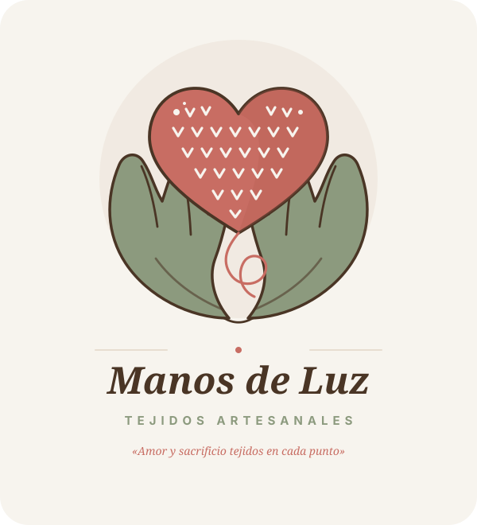

# Manual de Identidad Visual y Sistema de Diseño: "Manos de Luz"

> **Versión del Manual:** 2.0 — Sistema Vectorial y Proporciones UI/UX  
> **Fecha de Creación / Actualización:** 11 de Noviembre de 2026  
> **Empresa:** Manos de Luz (Tejidos Manos de Luz)  
> **Fundación del Proyecto:** 30 de Septiembre de 1985  
> **Slogan:** *«Amor y sacrificio tejidos en cada punto.»*  

---

## 1. Perfil e Historia de la Empresa

**Manos de Luz** es un taller artesanal dedicado al diseño y confección de muñecas y piezas amigurumis tejidas totalmente a mano. Desde su nacimiento el **30 de septiembre de 1985**, cada creación rescata la calidez del trabajo hecho con paciencia, esmero e hilados de algodón de la más alta calidad, transformando cada puntada en un personaje entrañable que atesora momentos memorables.

### Pilares y Propuesta de Valor
1. **Conexión Emocional:** Las creaciones trascienden el objeto decorativo para convertirse en compañeros de vida cargados de afecto, ideales para obsequiar a seres queridos o celebrar el nacimiento y la infancia.
2. **Diseño Personalizado:** Cada amigurumi puede adaptarse a las ideas y peticiones de las familias, asegurando que cada detalle refleje una historia particular.
3. **Calidad Artesanal:** Confección 100% manual con hilado hipoalergénico, estructura indeformable y costuras reforzadas pensadas para perdurar por generaciones.

### Canales Oficiales de Contacto
- **Instagram:** [@tejidos.manosdeluz](https://instagram.com/tejidos.manosdeluz)
- **WhatsApp:** [wa.me/51936372861](https://wa.me/51936372861)
- **Correos Electrónicos:** `tejidosmanosdeluz@gmail.com` | `cmedina.2508@gmail.com`

---

## 2. Concepto y Anatomía del Isotipo

El isotipo oficial se fundamenta en la síntesis poética de la labor de la artesana:  
**«Un corazón tejido ubicado y protegido entre dos manos abiertas en ofrenda»**.

```
             ┌─────────────────────────┐
             │   CORAZÓN AMIGURUMI     │ -> Terracota Rosado (#C86D63)
             │   Puntadas en V crochet │ -> Crema Algodón (#F7F4EE)
             └───────────┬─────────────┘
                         │ (acunado con ternura)
       ┌─────────────────┴─────────────────┐
       │                                   │
┌──────┴──────────────┐             ┌──────┴──────────────┐
│  MANO IZQUIERDA     │             │    MANO DERECHA     │ -> Verde Oliva Suave (#8C9A7E)
│  Curvas protectoras │             │    Acogida maternal │    Contorno Cacao (#4A3525)
└─────────────────────┘             └─────────────────────┘
```

### Separación Semántica de Capas (Adobe Illustrator Ready)
Para garantizar una edición limpia y sin fricciones en **Adobe Illustrator** u otros editores vectoriales vectoriales estándar (Inkscape, CorelDraw, Figma), el código fuente de los SVG se organiza en tres capas estructurales (`<g id="...">`):

1. `<g id="capa-manos">`: Contiene los trazados de las manos abiertas que nacen desde las muñecas y se despliegan en dedos estilizados. Relleno en Verde Oliva Suave (`#8C9A7E`) con filete de contorno y líneas de palma en Cacao Profundo (`#4A3525`).
2. `<g id="capa-corazon-tejido">`: Contiene la silueta del corazón en Terracota Rosado (`#C86D63`), la textura de puntadas en 'V' de crochet amigurumi en Crema Algodón (`#F7F4EE`) y la hebra continua de hilado que envuelve armónicamente la base.
3. `<g id="capa-textos">`: Contiene los elementos tipográficos editables con tipografías Lora y Nunito, o trazados convertidos a curvas para salida de imprenta.

---

## 3. Sistema Cromático Oficial: "Abrazo Artesanal"

Paleta de color extraída directamente del archivo original [AdobeColor A,IGURUMIS2.ase](file:///g:/Mi%20unidad/Documentos%20personales/2026_DLMEDIAPRO/05_Clientes/03_MANOS%20DE%20LUZ/color%20Oficial/AdobeColor%20A,IGURUMIS2.ase) y documentada en el [Manual de Paleta de Colores](file:///g:/Mi%20unidad/Documentos%20personales/2026_DLMEDIAPRO/05_Clientes/03_MANOS%20DE%20LUZ/color%20Oficial/Manual_Paleta_Colores_Amigurumis.pdf).

### Tabla de Códigos y Proporciones (Regla 60 - 25 - 10 - 5)

| Tono | Muestra | HEX | RGB | CMYK | Proporción | Función Psicológica y Visual |
| :--- | :---: | :---: | :---: | :---: | :---: | :--- |
| **Crema Algodón** | `[ #F7F4EE ]` | `#F7F4EE` | `247, 244, 238` | `2, 2, 5, 0` | **60% (Base)** | Lienzo principal. Transmite paz, descanso visual y pulcritud artesanal. Evita el blanco puro. |
| **Avena Tibia** | `[ #E8DDD0 ]` | `#E8DDD0` | `232, 221, 208` | `8, 12, 16, 0` | **25% (Soporte)** | Tarjetas, franjas y cajas de producto. Aporta sensación táctil de fibra natural. |
| **Cacao Profundo** | `[ #4A3525 ]` | `#4A3525` | `74, 53, 37` | `48, 62, 74, 55`| **25% (Soporte)** | Color oficial de textos, menú y contornos. Confiere autoridad artesanal y solidez. |
| **Verde Oliva Suave**| `[ #8C9A7E ]` | `#8C9A7E` | `140, 154, 126` | `43, 24, 47, 4` | **10% (Equilibrio)**| Manos en el imagotipo, insignias de confianza ("100% algodón", "Hecho a mano") e íconos. |
| **Terracota Rosado**| `[ #C86D63 ]` | `#C86D63` | `200, 109, 99` | `18, 67, 56, 3` | **5% (Acción)** | Imán emocional. Corazón tejido, botones de compra ("Adoptar muñeca") y badges de oferta. |

### Certificación de Contraste y Accesibilidad (WCAG 2.1 AA)

Toda combinación en el entorno web y gráfico ha sido auditada matemáticamente:
- **Cacao Profundo (`#4A3525`) sobre Crema Algodón (`#F7F4EE`):** Ratio **10.47:1** $\rightarrow$ **PASA AAA** (Mínimo requerido AA: 4.5:1).
- **Cacao Profundo (`#4A3525`) sobre Avena Tibia (`#E8DDD0`):** Ratio **8.58:1** $\rightarrow$ **PASA AAA** (Mínimo requerido AA: 4.5:1).
- **Terracota Rosado (`#C86D63`) sobre Crema Algodón (`#F7F4EE`):** Ratio **3.28:1** $\rightarrow$ **PASA AA** para elementos gráficos, iconos y textos en negrita $\ge 14\text{pt}$ (18.5px).
- **Crema Algodón (`#F7F4EE`) sobre Terracota Rosado (`#C86D63`):** Ratio **3.28:1** $\rightarrow$ Botones de compra deben usar **Nunito Bold** a tamaño $\ge 14\text{pt}$ para certificar cumplimiento normativo.

---

## 4. Sistema Tipográfico Oficial

Basado en las fuentes oficiales provistas en [Lora.zip](file:///g:/Mi%20unidad/Documentos%20personales/2026_DLMEDIAPRO/05_Clientes/03_MANOS%20DE%20LUZ/Lora.zip) y [Nunito.zip](file:///g:/Mi%20unidad/Documentos%20personales/2026_DLMEDIAPRO/05_Clientes/03_MANOS%20DE%20LUZ/Nunito.zip), e integradas mediante Google Fonts.

### 1. Tipografía Primaria: Lora (Serif)
- **Personalidad:** Elegante, editorial, cálida y de tradición artesanal.
- **Usos:**
  - **Lora Bold (700):** Logomarca "Manos de Luz", títulos H1 de colecciones principales y cabeceras de empaque.
  - **Lora SemiBold (600):** Títulos secundarios H2 y nombres de modelos de amigurumi.
  - **Lora Italic (400i):** Frases emotivas, acentos poéticos y slogan de la marca: *«Amor y sacrificio tejidos en cada punto.»*

### 2. Tipografía Secundaria: Nunito (Sans-Serif)
- **Personalidad:** Amable, redondeada, cercana y altamente legible en pantallas y dispositivos móviles.
- **Usos:**
  - **Nunito Regular (400):** Cuerpo de texto, historias de cada muñeca, descripciones técnicas (interlineado recomendado: 1.5 a 1.6).
  - **Nunito SemiBold (600):** Descriptor artesanal en mayúsculas (`TEJIDOS ARTESANALES`) con espaciado entre letras (`letter-spacing: 5px a 6px`).
  - **Nunito Bold / ExtraBold (700/800):** Botones de llamada a la acción ("Adoptar muñeca", "Personalizar pedido"), precios y menús de navegación móvil.

---

## 5. Variaciones Vectoriales Disponibles

Se han generado 3 archivos SVG vectoriales nativos en la carpeta [`vectores/`](file:///g:/Mi%20unidad/Documentos%20personales/2026_DLMEDIAPRO/05_Clientes/03_MANOS%20DE%20LUZ/vectores/):

| Archivo | ViewBox | Capas Semánticas | Líneas | Caso de Uso Principal |
| :--- | :---: | :--- | :---: | :--- |
| [`isologo-principal.svg`](file:///g:/Mi%20unidad/Documentos%20personales/2026_DLMEDIAPRO/05_Clientes/03_MANOS%20DE%20LUZ/vectores/isologo-principal.svg) | `0 0 600 660` | `capa-manos`, `capa-corazon-tejido`, `capa-textos` | 170 | Cabeceras web, banners, folletos, empaques frontales y catálogos. |
| [`isologo-monocromatico.svg`](file:///g:/Mi%20unidad/Documentos%20personales/2026_DLMEDIAPRO/05_Clientes/03_MANOS%20DE%20LUZ/vectores/isologo-monocromatico.svg) | `0 0 600 660` | `capa-manos`, `capa-corazon-tejido`, `capa-textos` | 165 | Sellos de goma, bolsas kraft, bordado a un tono, facturación y grabado láser en madera. |
| [`isotipo-aislado.svg`](file:///g:/Mi%20unidad/Documentos%20personales/2026_DLMEDIAPRO/05_Clientes/03_MANOS%20DE%20LUZ/vectores/isotipo-aislado.svg) | `0 0 512 512` | `capa-manos`, `capa-corazon-tejido` | 156 | Avatar de Instagram (@tejidos.manosdeluz), favicons, stickers circulares y etiquetas tejidas. |

### Cumplimiento de Restricciones Técnicas
- **Máximo de líneas:** Los tres archivos cumplen estrictamente el límite de $\le 250$ líneas (156, 170 y 165 líneas respectivamente).
- **Separación de Responsabilidades (SoC):** Cada archivo aísla sus estilos en un bloque `<style>` scoped en la cabecera del SVG, empleando clases semánticas reutilizables.
- **Adobe Illustrator:** No contiene etiquetas foráneas (`foreignObject`), scripts ni bitmaps embebidos. Permite abrir el archivo directamente en Illustrator y encontrar las capas organizadas e independientes.

---

## 6. Retícula, Proporciones y Área de Seguridad

### Módulo Base $X$
Se define como unidad modular $X$ la altura de la letra mayúscula **"M"** del logotipo principal.
- **Área de Aislamiento:** Todo el imagotipo debe contar con un margen perimetral libre de elementos ajenos de al menos **$1.5X$**.
- **Proporción Isotipo vs Bloque Tipográfico:** En la versión vertical, el isotipo ocupa el 60% del peso visual superior, y el bloque tipográfico ocupa el 40% inferior, separados por un respiro de $1X$.

```
┌──────────────────────────────────────────────┐
│                  [ 1.5 X ]                   │
│         ┌──────────────────────────┐         │
│         │                          │         │
│ [1.5X]  │         ISOTIPO          │  [1.5X] │
│         │    (Corazón + Manos)     │         │
│         │                          │         │
│         └─────────────┬────────────┘         │
│                   [ 1.0 X ]                  │
│         ┌─────────────┴────────────┐         │
│         │       Manos de Luz       │         │
│         │    TEJIDOS ARTESANALES   │         │
│         └──────────────────────────┘         │
│                  [ 1.5 X ]                   │
└──────────────────────────────────────────────┘
```

### Tamaños Mínimos de Reproducción
- **Digital:**
  - Isotipo aislado: Mínimo **16x16px** (Favicon tab estándar) / **32x32px** (Retina).
  - Isologo principal: Mínimo **140px** de ancho para garantizar legibilidad completa del descriptor y tipografía serif.
- **Impresión Física:**
  - Sellos de goma o tampografía: Mínimo **20 mm** de diámetro para el isotipo.
  - Etiquetas bordadas de amigurumi: Mínimo **30 mm** de ancho.

---

## 7. Usos Permitidos e Incorrectos

### Usos Permitidos
- Aplicar el isologo sobre fondos oficiales: Crema Algodón (`#F7F4EE`) y Avena Tibia (`#E8DDD0`).
- Usar la versión monocromática en tinta Cacao Profundo (`#4A3525`) sobre papel kraft, cartón corrugado o madera.
- Usar el isotipo aislado dentro de contenedores circulares para avatares de redes sociales.

### Usos Prohibidos
- **NO distorsionar ni estirar:** Mantener siempre `preserveAspectRatio="xMidYMid meet"` bloqueando la relación de aspecto.
- **NO alterar la paleta cromática:** Prohibido teñir el corazón de colores no oficiales (ej. rojo saturado `#FF0000` o azul).
- **NO cambiar las tipografías:** No sustituir Lora por fuentes manuscritas ilegibles ni Nunito por fuentes de ancho fijo.
- **NO invadir el área de seguridad:** No colocar textos o ilustraciones pegados a los contornos de las manos.
- **NO aplicar sombras rasterizadas pesadas:** Evitar sombras borrosas que ensucien la estética artesanal y limpia.

---

## 8. Directrices de Aplicación Web y Redes Sociales

### 1. Implementación Web con 0 CLS (Cumulative Layout Shift = 0)
Para evitar cualquier salto en la carga web (CLS):
```html
<!-- Ejemplo de integración con proporciones fijas -->
<div class="logo-wrapper" style="aspect-ratio: 600 / 660; max-width: 300px;">
  
</div>
```

### 2. Laboratorio de Pruebas Multi-Viewport
Para auditar la respuesta espacial en **Mobile (375px)**, **Tablet (768px)** y **Desktop (1440px)**, abrir en el navegador el banco interactivo:
- [`preview-testbench.html`](file:///g:/Mi%20unidad/Documentos%20personales/2026_DLMEDIAPRO/05_Clientes/03_MANOS%20DE%20LUZ/preview-testbench.html) (cuenta con telemetría activa en tiempo real `PerformanceObserver`).

### 3. Redes Sociales (Instagram & TikTok)
- **Feed de Instagram:** Alternar fotografías de las muñecas con luz cálida natural y piezas gráficas informativas usando fondo Crema Algodón (`#F7F4EE`) y textos en Lora Bold `#4A3525`.
- **Historias y Reels:** Portadas de historias destacadas alternando círculos en Avena Tibia, Verde Oliva y Terracota Rosado con el isotipo en Crema Algodón. Subtítulos de videos en Nunito Bold `#4A3525` sobre caja crema redondeada al 90% de opacidad.
- **Botones de Conversión en Web:** Siempre pintar los botones en Terracota Rosado (`#C86D63`) con texto en Crema Algodón (`#F7F4EE`) en **Nunito Bold**, asegurando el área táctil mínima de **44x44px**.

---

## 9. Archivos de Referencia y Documentación

- **Manual de Identidad Visual (PDF):** [Manual_Identidad_Visual_Amigurumis-v2.pdf](file:///g:/Mi%20unidad/Documentos%20personales/2026_DLMEDIAPRO/05_Clientes/03_MANOS%20DE%20LUZ/color%20Oficial/Manual_Identidad_Visual_Amigurumis-v2.pdf)
- **Manual de Paleta de Colores (PDF):** [Manual_Paleta_Colores_Amigurumis.pdf](file:///g:/Mi%20unidad/Documentos%20personales/2026_DLMEDIAPRO/05_Clientes/03_MANOS%20DE%20LUZ/color%20Oficial/Manual_Paleta_Colores_Amigurumis.pdf)
- **Muestra Oficial de Color (ASE):** [AdobeColor A,IGURUMIS2.ase](file:///g:/Mi%20unidad/Documentos%20personales/2026_DLMEDIAPRO/05_Clientes/03_MANOS%20DE%20LUZ/color%20Oficial/AdobeColor%20A,IGURUMIS2.ase)
- **Perfil e Información Corporativa:** [Información de la Empresa - Manos de Luz.docx](file:///g:/Mi%20unidad/Documentos%20personales/2026_DLMEDIAPRO/05_Clientes/03_MANOS%20DE%20LUZ/Informaci%C3%B3n%20de%20la%20Empresa%20-%20Manos%20de%20Luz.docx)
- **Fuentes Tipográficas:** [Lora.zip](file:///g:/Mi%20unidad/Documentos%20personales/2026_DLMEDIAPRO/05_Clientes/03_MANOS%20DE%20LUZ/Lora.zip) | [Nunito.zip](file:///g:/Mi%20unidad/Documentos%20personales/2026_DLMEDIAPRO/05_Clientes/03_MANOS%20DE%20LUZ/Nunito.zip)
- **Plan de Implementación:** [2026-11-11-identidad-vectorial-manos-de-luz.md](file:///g:/Mi%20unidad/Documentos%20personales/2026_DLMEDIAPRO/05_Clientes/03_MANOS%20DE%20LUZ/docs/superpowers/plans/2026-11-11-identidad-vectorial-manos-de-luz.md)

